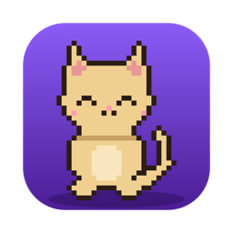

<p align="center">
  
</p>

<h1 align="center">PixelMate</h1>

<p align="center">
  Una mascota pixel art que vive en el escritorio de tu Mac y te acompaña
  mientras trabajas, estudias o juegas.
</p>

---

## Qué hace

- **Jornadas con descansos** — modos trabajo, estudio y juego, con bloques
  de enfoque y descansos cortos y largos. La cuenta regresiva se ve en la
  barra de menú.
- **Una mascota viva** — gato, perro o zorro en pixel art, con 15
  animaciones: teclea en su laptop, lee, juega, se estira, duerme, pasea por
  el escritorio y reacciona según la hora del día.
- **Chat con IA gratis y privada** — usa la IA de Apple en tu Mac (Apple
  Intelligence): sin internet ni costo. Sabe cómo va tu jornada y puede
  empezarla, pausarla o cambiar tu meta cuando se lo pides. Claude queda
  como opción con API key.
- **Asistente** — «recuérdame en 20 minutos llamar a mamá», «apunta comprar
  leche», «¿qué tengo pendiente?», «reproduce Despacito en Brave», «abre
  Spotify», «¿qué tengo hoy?», «crea una reunión mañana a las 10», «abre VS
  Code y haz un script de Python para sumar» (lo escribe la IA de Apple, te
  pregunta dónde guardarlo y lo abre en tu editor). Las
  órdenes claras se entienden al instante (aunque tengan faltas) y usan tu
  Calendario de macOS; las tareas y recordatorios se ven en el panel
  «Pendientes».
- **Te cuida** — guardián del enfoque (avisa si WhatsApp, Mensajes o un
  juego siguen al frente durante el enfoque), consejos de bienestar en los
  descansos y recordatorio para descansar si trabajas hasta muy tarde.
- **Progreso** — XP, niveles, títulos, 12 logros, accesorios y mascotas que
  se desbloquean, meta diaria y una racha amable que no castiga descansar.
- **Estadísticas** — hoy, semana y mes por modo, resumen semanal con un
  comentario de la mascota y exportación a CSV.
- **Detalles** — detecta tu editor o tus juegos y propone un modo, atajo
  global ⌃⌥P para abrir el chat, sonidos 8-bit opcionales, modo enfoque
  profundo y se abre al iniciar sesión.

## Instalar

1. Descarga `PixelMate-1.0.0-macOS.zip` desde
   [Releases](https://github.com/tulcansantiago08-cell/PixelMate/releases).
2. Descomprímelo y arrastra **PixelMate.app** a **Aplicaciones**.
3. La primera vez, haz **clic derecho → Abrir** (la app no está firmada por
   un desarrollador registrado de Apple, así que macOS lo pide una vez).

**Requisitos:** macOS 12 o posterior. El chat gratis necesita macOS 26 o
posterior con Apple Intelligence activado.

## Privacidad

Todo se guarda solo en tu Mac (SQLite y preferencias locales). La IA de
Apple funciona en el propio equipo. La detección de apps solo mira qué app
está al frente, nunca lo que ves o escribes. Cuando pides reproducir algo
(«reproduce Despacito»), la app busca esa canción en YouTube para abrir el
video. Una vez al día pregunta a GitHub cuál es la última versión (sin
enviar datos tuyos; se puede apagar en Ajustes). Las capturas de pantalla solo se envían si usas Claude y pulsas el
botón de la cámara.

## Compilar desde el código

```bash
flutter pub get
flutter test
flutter build macos --release
```

La app queda en `build/macos/Build/Products/Release/PixelMate.app`.

Para Claude (opcional):

```bash
flutter run -d macos --dart-define=ANTHROPIC_API_KEY=tu_clave
```

El arte se genera con código: `tool/sprites/generate_cat.py` (mascotas y
accesorios), `tool/sprites/generate_icon.py` (ícono) y
`tool/sounds/generate_sounds.py` (sonidos).

## Estructura

```
lib/
  domain/          reglas puras (jornada, especies, accesorios, horario)
  application/     estado y lógica (jornada, IA, logros, estadísticas…)
  infrastructure/  SQLite, canales nativos de macOS, IA de Apple y Claude
  presentation/    ventana de la mascota, paneles, chat y barra de menú
macos/Runner/      código Swift (IA de Apple, atajo, sonidos, inicio de sesión…)
```

Hecho con Flutter y Swift.
