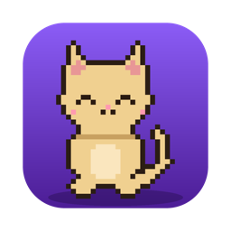

<p align="center">
  
</p>

<h1 align="center">PixelMate</h1>

<p align="center">
  Una mascota pixel art que vive en el escritorio de tu Mac y te acompaña
  mientras trabajas, estudias o juegas.
</p>

---

## Qué hace

- **Jornadas con descansos** — modos trabajo, estudio y juego, con bloques
  de enfoque y descansos cortos y largos. La cuenta regresiva se ve en la
  barra de menú.
- **Una mascota viva** — gato, perro o zorro en pixel art, con 15
  animaciones: teclea en su laptop, lee, juega, se estira, duerme, pasea por
  el escritorio, reacciona según la hora del día y baila cuando suena
  Spotify o Música (y te dice qué canción es).
- **Chat con IA gratis y privada** — usa la IA de Apple en tu Mac (Apple
  Intelligence): sin internet ni costo. Sabe cómo va tu jornada y puede
  empezarla, pausarla o cambiar tu meta cuando se lo pides. Claude queda
  como opción con API key.
- **Háblale** — toca 🎙️ en el chat o pulsa ⌃⌥V desde cualquier app y dile
  lo que necesites: entiende español con el reconocimiento de voz de Apple,
  deja de escuchar sola cuando te callas y te responde en voz alta (se puede
  apagar en Ajustes).
- **Asistente** — «recuérdame en 20 minutos llamar a mamá», «apunta comprar
  leche», «¿qué tengo pendiente?», «reproduce Despacito en Brave», «abre
  Notas», «cierra Spotify», «sube el volumen», «bájale un poco», «volumen
  al 50», «silencia», «empieza mi jornada», «¿qué tengo hoy?», «crea una
  reunión mañana a las 10», «abre VS Code y haz un script de Python para
  sumar» (lo escribe la IA de Apple, te pregunta dónde guardarlo y lo abre
  en tu editor). Las órdenes claras se entienden al instante (aunque tengan
  faltas o se las digas con «¿puedes…?») y usan tu Calendario de macOS;
  las tareas y recordatorios se ven en el panel «Pendientes». Antes de
  cerrar una app o quitar una alarma te pregunta («¿Cierro Safari?») y
  espera tu «sí».
- **Alarmas** — «pon una alarma a las 8 am reunión virtual», «despiértame a
  las 6», «alarma de lunes a viernes a las 7 gimnasio». Suenan con un bip que
  se repite, la mascota aparece con la hora y el texto y te lo dice en voz
  alta; «😴 5 min» o «pospón 10 minutos» la vuelven a sonar y «apaga la
  alarma» la para. En Ajustes eliges el sonido (bip, campana o suave),
  cuánto se pospone y si te avisa unos minutos antes. En el botón ⏰ están
  tus **tareas diarias** (suenan los días que elijas y se tachan cada día).
- **Calendario** — en la pestaña 📅 del botón ⏰ anotas cosas en cualquier
  día, todo el día o a una hora (con alarma si quieres), con un color; el
  día queda marcado de ese color y ese día te avisa. Elige un día y escribe
  directo; toca una nota para cambiarla o repetirla cada semana o cada año.
  También por chat o voz: «anota en mi calendario el viernes cumpleaños de
  mamá» (los cumpleaños se repiten solos). Si lo activas, se copian al
  Calendario del Mac. Los recordatorios del chat quedan en el calendario
  (en gris) después de avisar.
- **Escóndelo cuando quieras** — el botón del ojo (o «Esconder» en el menú
  ⋯) lo quita de la pantalla; sigue en la barra de menú y vuelve con
  «Oye James» o ⌃⌥P.
- **Resumen del día** — por la mañana te cuenta lo que tienes hoy
  (calendario, tareas diarias, recordatorios y Calendario del Mac) y cuántas
  tareas te quedan. «¿Qué tengo hoy?» o «¿qué tengo mañana?» te lo dicen
  cuando quieras.
- **En tu iPhone** — activa «También en Recordatorios (iPhone)» en
  Pendientes: tus tareas y recordatorios se guardan en la app Recordatorios
  y llegan al iPhone por iCloud; lo que taches allí se tacha aquí.
- **Modo Concentración** — en Ajustes, PixelMate activa tu modo
  Concentración al empezar el enfoque y lo quita en los descansos (con dos
  atajos de la app Atajos).
- **Notas rápidas** — «toma nota: …» o «guarda esta idea: …», por voz o
  escrito; quedan en Pendientes › Notas.
- **Copia de seguridad** — en Ajustes, «Guardar…» guarda tus tareas,
  calendario, alarmas y ajustes en un archivo y «Restaurar…» los recupera
  (por ejemplo, en otro Mac).
- **Te cuida** — guardián del enfoque (avisa si WhatsApp, Mensajes o un
  juego siguen al frente durante el enfoque), consejos de bienestar en los
  descansos y recordatorio para descansar si trabajas hasta muy tarde.
- **Minijuego en los descansos** — «Atrapa estrellas» (botón 🌟 junto a la
  mascota): lleva la cesta con el ratón o las flechas, atrapa ⭐ y 🌟 y
  esquiva las trampas hasta perder tus 3 vidas. Cada nivel cambia el cielo,
  va más rápido, achica la cesta y trae trampas nuevas (💣 bombas, 🧊 hielo
  que congela, 🌀 remolinos que invierten los controles, 🍄 hongos que
  encogen, 💀 estrellas falsas) y ayudas (💖 vida, 🧲 imán, 🛡️ escudo).
  Atrapar seguidas multiplica los puntos (combo 🔥) y 7 medallas desbloquean
  cestas con truco (🪣 🎩 🍯 🛸 🌈 👑 🐉). Cada día hay un 🎯 reto nuevo que
  da XP extra y lleva racha. En cada descanso, una partida da hasta 15 XP;
  fuera de ellos se juega por el récord.
- **Progreso** — XP, niveles, títulos, 12 logros, accesorios y mascotas que
  se desbloquean, meta diaria y una racha amable que no castiga descansar.
- **Estadísticas** — hoy, semana y mes por modo, resumen semanal con un
  comentario de la mascota y exportación a CSV.
- **Álbum** — todo lo que se puede conseguir en un solo lugar (mascotas,
  accesorios, aura, logros, medallas y cestas del juego), con lo que falta
  para cada pieza; lo desbloqueado se pone desde ahí.
- **Detalles** — detecta tu editor o tus juegos y propone un modo, atajos
  globales ⌃⌥P para abrir el chat y ⌃⌥V para hablarle, sonidos 8-bit
  opcionales, modo enfoque profundo y se abre al iniciar sesión.

## Instalar

1. Descarga `PixelMate-1.4.0-macOS.zip` desde
   [Releases](https://github.com/tulcansantiago08-cell/PixelMate/releases).
2. Descomprímelo y arrastra **PixelMate.app** a **Aplicaciones**.
3. La primera vez, haz **clic derecho → Abrir** (la app no está firmada por
   un desarrollador registrado de Apple, así que macOS lo pide una vez).

**Requisitos:** macOS 12 o posterior. El chat gratis necesita macOS 26 o
posterior con Apple Intelligence activado.

### Windows y Linux

1. Descarga `PixelMate-windows.zip` o `PixelMate-linux-x64.tar.gz` desde
   [Releases](https://github.com/tulcansantiago08-cell/PixelMate/releases)
   (o, de una rama, desde la pestaña *Actions* → *Compilar* → *Artifacts*).
2. **Windows:** descomprime la carpeta y abre `pixelmate.exe`. Si SmartScreen
   avisa, *Más información → Ejecutar de todas formas* (la app no está firmada).
3. **Linux:** descomprime y abre `./pixelmate`. Necesita GTK 3 y, para el ícono
   de la bandeja, `libayatana-appindicator3` (en Ubuntu:
   `sudo apt install libayatana-appindicator3-1`).

En Windows y Linux están la mascota, las jornadas, estadísticas, logros, el
juego, tareas diarias, alarmas, calendario propio, recordatorios, sonidos,
avisos, el menú de la bandeja, los dos idiomas y abrir webs y apps desde el
chat. El chat con IA usa Claude (con API key). Lo que depende del Mac no
aparece: la IA de Apple, la voz y «Oye …», detectar apps y el guardián del
enfoque, controlar música y volumen, el Calendario, Contactos y Recordatorios
de Apple, Concentración, los atajos globales y abrir al iniciar sesión.

## Privacidad

Todo se guarda solo en tu Mac (SQLite y preferencias locales). La IA de
Apple funciona en el propio equipo. La detección de apps solo mira qué app
está al frente, nunca lo que ves o escribes. Cuando pides reproducir algo
(«reproduce Despacito»), la app busca esa canción en YouTube para abrir el
video. Para bailar con la música solo escucha el aviso de cambio de canción
que publican Spotify y Música (título y artista). Una vez al día pregunta a
GitHub cuál es la última versión (sin enviar datos tuyos; se puede apagar en
Ajustes). El micrófono solo se usa mientras le hablas (🎙️ o ⌃⌥V); lo
transcribe el reconocimiento de voz de Apple, en el propio Mac cuando el
idioma lo permite. Las capturas de pantalla solo se envían si usas Claude y
pulsas el botón de la cámara.

## Compilar desde el código

```bash
flutter pub get
flutter test
flutter build macos --release     # en un Mac
flutter build windows --release   # en Windows
flutter build linux --release     # en Linux
```

En macOS la app queda en `build/macos/Build/Products/Release/PixelMate.app`.
Cada sistema solo compila su propia versión; el workflow *Compilar*
(`.github/workflows/build.yml`) arma las tres en GitHub en cada push y las
publica en el release al subir una etiqueta `v*`.

Para Claude (opcional):

```bash
flutter run -d macos --dart-define=ANTHROPIC_API_KEY=tu_clave
```

El arte se genera con código: `tool/sprites/generate_cat.py` (mascotas y
accesorios), `tool/sprites/generate_icon.py` (ícono) y
`tool/sounds/generate_sounds.py` (sonidos).

## Estructura

```
lib/
  domain/          reglas puras (jornada, especies, accesorios, horario)
  application/     estado y lógica (jornada, IA, logros, estadísticas…)
  infrastructure/  SQLite, canales nativos de macOS, IA de Apple y Claude
  presentation/    ventana de la mascota, paneles, chat y barra de menú
macos/Runner/      código Swift (IA de Apple, atajo, sonidos, inicio de sesión…)
```

Hecho con Flutter y Swift.
